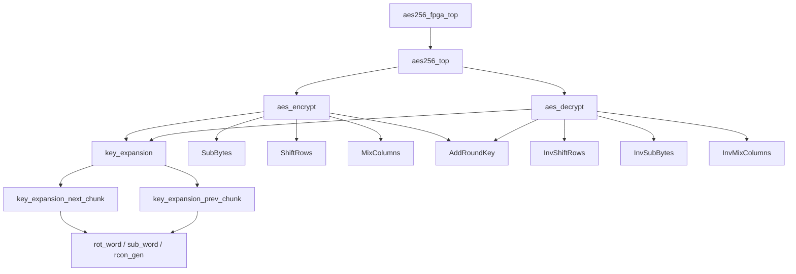

# AES-256 FPGA Core — Verilog / Xilinx Vivado

Hardware implementation of an **AES-256 encryption/decryption core** developed in Verilog as part of the thesis:

> **Design of an Encryption/Decryption Algorithm for Secure Communication and FPGA Implementation with Resilience to Cyberattacks**

The repository contains the FPGA side of the project: synthesizable RTL, simulation testbenches and constraints.  
The software communication system developed for the thesis is maintained separately.

---

## Overview

The design implements the AES-256 block cipher with:

- 128-bit data blocks
- 256-bit encryption key
- 14 AES rounds
- encryption and decryption
- on-the-fly key expansion
- iterative round architecture
- unit-level and full-core verification in Vivado Simulator (XSIM)

The main design choice is an **iterative architecture**. Instead of instantiating fourteen separate round datapaths, the same round logic is reused from one clock cycle to the next. The intermediate AES state is stored in a 128-bit register and fed back into the datapath for the following round.

This keeps the hardware footprint relatively small and leaves FPGA resources available for future interfaces or security extensions.

---

## Repository structure

```text
.
├── sources_1/        # Synthesizable Verilog RTL
├── sim_1/            # Simulation-only testbenches
├── constrs_1/        # Vivado constraints (.xdc)
├── docs/
│   └── images/       # Verification and synthesis screenshots
├── LICENSE
└── README.md
```

### Recommended additions

For a clean GitHub repository, I also recommend keeping:

```text
.gitignore
create_project.tcl    # optional, but useful for recreating the Vivado project
```

A fresh project recreation script can be exported from Vivado with `write_project_tcl`.

---

## Architecture

The RTL is organized hierarchically.



### Top-level flow

`aes256_fpga_top.v` is the FPGA-facing wrapper. The internal AES core uses wide 128-bit and 256-bit buses, which are convenient inside the FPGA but impractical to expose directly as physical pins. The wrapper therefore loads data and key bytes through a smaller external interface, stores them internally, starts the AES core, and returns the result byte by byte.

`aes256_top.v` is the common encryption/decryption controller. The `mode` input selects the active operation:

- `mode = 0`: encryption
- `mode = 1`: decryption

The top module also manages the `start`, `busy` and `done` handshake and returns the selected result on `data_out`.

---

## AES-256 encryption

The encryption core is implemented in `aes_encrypt.v`.

AES-256 uses **14 rounds**. The datapath performs:

1. Initial `AddRoundKey`
2. Rounds 1–13:
   - `SubBytes`
   - `ShiftRows`
   - `MixColumns`
   - `AddRoundKey`
3. Final round:
   - `SubBytes`
   - `ShiftRows`
   - `AddRoundKey`

The final round intentionally skips `MixColumns`, as required by AES.

The intermediate 128-bit state is stored after every round and reused by the same combinational datapath in the next cycle.

---

## AES-256 decryption

The decryption core is implemented in `aes_decrypt.v`.

The inverse datapath performs:

1. Initial `AddRoundKey` with round key 14
2. Rounds 13 down to 1:
   - `InvShiftRows`
   - `InvSubBytes`
   - `AddRoundKey`
   - `InvMixColumns`
3. Final inverse round:
   - `InvShiftRows`
   - `InvSubBytes`
   - `AddRoundKey`

The final inverse round does not use `InvMixColumns`.

### Reverse round-key handling

AES key expansion naturally generates round keys in the forward direction, while decryption needs them in reverse order.

The implementation solves this in two stages:

- **Forward priming:** key expansion advances until round key 14 is available.
- **Backward reconstruction:** previous 256-bit key chunks are reconstructed while decryption progresses from round 13 back to round 0.

This avoids storing the complete expanded key schedule in memory.

---

## Key expansion

The AES-256 key schedule is split into reusable modules.

| Module | Purpose |
|---|---|
| `key_expansion.v` | Holds the current 256-bit key chunk and controls forward/backward movement. |
| `key_expansion_next_chunk.v` | Generates the next 256-bit key-schedule chunk. |
| `key_expansion_prev_chunk.v` | Reconstructs the previous chunk for decryption. |
| `rot_word.v` | Rotates the four bytes of a 32-bit word. |
| `sub_word.v` | Applies the AES S-box to the four bytes of a word. |
| `rcon_gen.v` | Generates the AES round constant. |

Each 256-bit key chunk contains two consecutive 128-bit round keys.

The design generates round keys **on the fly**, rather than storing every round key at once.

---

## AES datapath modules

### SubBytes / InvSubBytes

`sbox.v` and `inv_sbox.v` implement the AES byte substitution tables.

`sub_bytes_state.v` applies sixteen S-box substitutions in parallel to the complete 128-bit state.  
`inv_sub_bytes_state.v` performs the inverse operation during decryption.

### ShiftRows / InvShiftRows

`shift_rows.v` only rearranges byte positions. No arithmetic unit is required.

The rows are cyclically shifted by 0, 1, 2 and 3 positions respectively.  
`inv_shift_rows.v` applies the inverse permutation.

### MixColumns / InvMixColumns

`mix_columns.v` processes the four 32-bit columns of the AES state in parallel.

The required finite-field multiplications are built from XOR operations and the `xtime` operation rather than a general-purpose multiplier.

Supporting modules include:

| Module | Purpose |
|---|---|
| `gf_xtime.v` | Multiplication by `02` in GF(2^8). |
| `gf_mult_encode.v` | Constant multiplications required by MixColumns. |
| `gf_mult_decode.v` | Constant multiplications required by InvMixColumns. |
| `mix_single_column.v` | Forward transformation for one column. |
| `inv_mix_single_column.v` | Inverse transformation for one column. |

### AddRoundKey

`add_round_key.v` performs a 128-bit XOR between the AES state and the selected round key.

The same XOR operation is valid for both encryption and decryption.

---

## Control logic

The encryption and decryption cores use finite-state machines to coordinate:

- loading input data
- loading the original key
- round counting
- key-schedule advancement
- datapath updates
- result capture
- completion signalling

The control logic is separate from the combinational AES transformations, which keeps the design modular and makes individual units easier to verify.

---

## Verification

Verification was performed incrementally, starting with individual combinational blocks and ending with the complete AES-256 core.

### RotWord / SubWord unit test

The RotWord and SubWord modules were checked against a worked AES key-expansion example. For the input word:

```text
09cf4f3c
```

the design produced:

```text
RotWord  = cf4f3c09
SubWord  = 8a84eb01
```

<p align="center">
  
</p>

<p align="center">
  
</p>

---

## Full AES-256 known-answer test

The complete core was verified with the AES-256 known-answer vector:

```text
Plaintext:
00112233445566778899aabbccddeeff

Key:
000102030405060708090a0b0c0d0e0f
101112131415161718191a1b1c1d1e1f

Expected ciphertext:
8ea2b7ca516745bfeafc49904b496089
```

The encryption result matched the expected ciphertext. Decryption of that ciphertext recovered the original plaintext.

The simulation also confirmed the round trip:

```text
D_K(E_K(P)) = P
```

In the XSIM testbench used for the thesis, encryption completed after **18 clock cycles** and decryption after **26 clock cycles**.

<p align="center">
  
</p>

<p align="center">
  
</p>

---

## FPGA synthesis results

Vivado synthesis produced the following resource utilization:

| Resource | Used | Available | Utilization |
|---|---:|---:|---:|
| LUT | 4,119 | 134,600 | 3.06% |
| Flip-Flops | 1,731 | 269,200 | 0.64% |
| BRAM | 2 | 365 | 0.55% |
| I/O | 28 | 500 | 5.60% |

<p align="center">
  
</p>

The low LUT and register utilization is consistent with the iterative architecture: one round datapath is reused instead of duplicating the complete AES round fourteen times.

The reduced external I/O count comes from the byte-oriented FPGA wrapper rather than exposing the internal 128-bit data buses and 256-bit key bus directly as device pins.

---

## Running the project in Vivado

A typical Vivado setup is:

1. Create a new RTL project.
2. Add the files under `sources_1/` as **Design Sources**.
3. Add the files under `sim_1/` as **Simulation Sources**.
4. Add the `.xdc` file from `constrs_1/` as a **Constraint Source**.
5. Use `aes256_fpga_top` as the synthesis top when targeting the FPGA-facing interface.
6. Select the relevant testbench as simulation top and run **Behavioral Simulation** in XSIM.
7. Run synthesis and open the utilization report to inspect LUT, FF, BRAM and I/O usage.

For a reproducible GitHub project, exporting a Vivado project recreation script is recommended:

```tcl
write_project_tcl create_project.tcl
```

---

## Suggested repository layout

```text
.
├── sources_1/
│   └── ... Verilog design sources
├── sim_1/
│   └── ... Verilog testbenches
├── constrs_1/
│   └── ... XDC constraints
├── docs/
│   └── images/
│       ├── rotword_subword_waveform.png
│       ├── rotword_subword_console.png
│       ├── aes256_xsim_waveform.png
│       ├── aes256_xsim_console.png
│       └── vivado_utilization.png
├── create_project.tcl        # recommended
├── .gitignore                # recommended
├── LICENSE
└── README.md
```

---

## Security scope

This repository implements and verifies the AES-256 hardware core.

The wider thesis also discusses resilience against cyberattacks, including hardware side-channel attacks. The current RTL does **not** claim resistance to physical side-channel analysis and does not include dedicated countermeasures such as masking, timing randomization or asynchronous logic.

Possible future extensions include:

- side-channel countermeasures
- AES-GCM / authenticated-encryption support
- UART, SPI or AXI interfaces
- real-board latency and throughput measurements
- timing-closure and power analysis
- fault-detection mechanisms

---

## Thesis context

This FPGA implementation is the hardware part of a broader thesis project combining:

- secure client-server communication in software
- AES-based data protection
- AES-256 RTL design in Verilog
- functional verification in XSIM
- FPGA synthesis and resource analysis
- discussion of software and hardware attack surfaces

---

## License

See the `LICENSE` file included in the repository.
